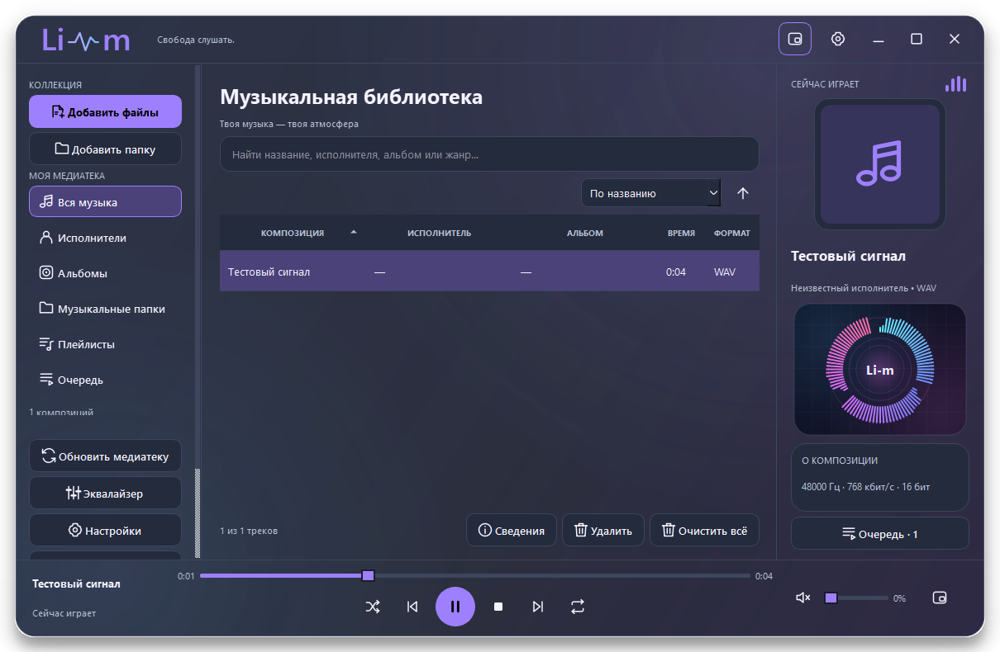

# Li-m

**Свобода слушать.** Бесплатный музыкальный проигрыватель для Windows 11 x64.
Без рекламы, подписки и обязательной регистрации. Автор — **Анохин Михаил**.

## Скачать

Предварительный выпуск **0.9.0-rc.10** доступен в [Releases](https://github.com/Lion-ls36/Li-m/releases/tag/v0.9.0-rc.10).

- [Скачать установщик](https://github.com/Lion-ls36/Li-m/releases/download/v0.9.0-rc.10/Li-m-0.9.0-rc.10-Setup.exe)
- [Скачать портативную версию](https://github.com/Lion-ls36/Li-m/releases/download/v0.9.0-rc.10/Li-m-0.9.0-rc.10-portable.zip)
- [Контрольные суммы](https://github.com/Lion-ls36/Li-m/releases/download/v0.9.0-rc.10/SHA256SUMS.txt)

Выберите установщик для обычной установки или portable для запуска из распакованной папки.
Установленный Python не требуется. Распаковывайте portable целиком.

Это кандидат, а не стабильная версия 1.0. Сборки не подписаны сертификатом
издателя. [Что проверено и ограничения](TESTING.md). [Установка](INSTALL.md).

## Возможности

- Локальная медиатека: исполнители, альбомы, музыкальные папки и поиск.
- Плейлисты, отдельная очередь, случайный порядок и повтор.
- MP3, FLAC, WAV, OGG Vorbis, Opus, AAC/M4A, ALAC и WMA.
- Десятиполосный эквалайзер и шесть красочных визуализаций, включая Орбиту.
- Три темы, полупрозрачное оформление, мини-плеер и системный трей.
- Русский, английский и казахский интерфейс, резервные копии медиатеки.

Руководство: [Русский](GUIDE.ru.md) · [English](GUIDE.en.md) · [Қазақша](GUIDE.kk.md).
Плеер работает с локальной коллекцией; музыка не передаётся разработчику.
[Конфиденциальность](PRIVACY.md).

## Лицензия и компоненты

Li-m — Freeware: бесплатное личное и коммерческое использование,
передача неизменённых официальных сборок с уведомлениями. Собственный
исходный код плеера в этом репозитории не размещается. [Условия](LICENSE).

Исходные материалы сторонних компонентов поставляются отдельным архивом
`Li-m-0.9.0-rc.10-third-party-materials.zip` вместе с выпуском.
Права Qt, FFmpeg и других библиотек сохраняются. [Материалы и замена](THIRD-PARTY.md).

## English

Li-m is a free local music player for Windows 11 x64: library folders,
playlists, a real 10-band equalizer, six visualizations, three themes and
Russian/English/Kazakh UI. No ads, subscription or account required.
Download the installer or portable archive from Releases. This RC is an
unsigned prerelease. Original player source is not included; third-party
source materials and notices are provided with the release.
